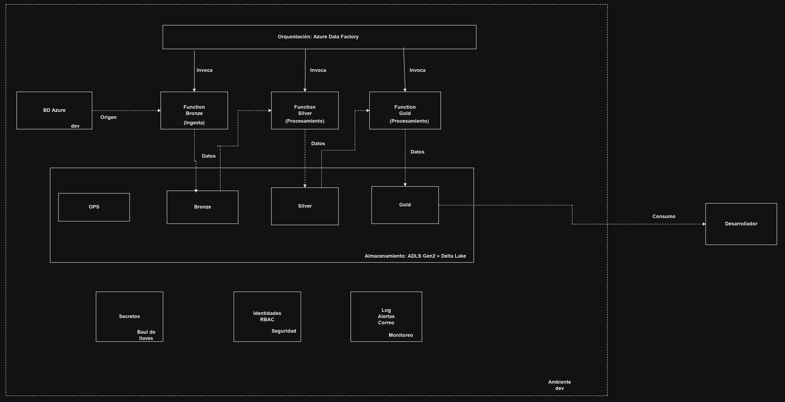
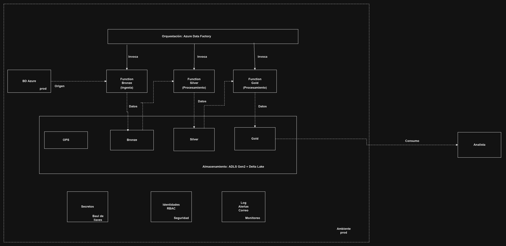

## Sector: Escenario B, Retail y comercio electrónico

Se realiza la selección del Escenario B, ya que este escenario me daba la oportunidad de trabajar con el tema de ventas, stock y devoluciones de tiendas, un área en la que no tengo tanta experiencia. El escenario A me sonaba llamativo y quizás lo use más adelante para seguir aprendiendo sobre este tema y mejorar el perfil de datos; sin embargo, para un primer contacto con este tipo de problemáticas, un enfoque más real y con problemáticas cotidianas permite que abstraer la información sirva como primer punto para entender el funcionamiento de las capas y así poder adecuar los conocimientos previos de mi perfil en este temario.

Desde lo técnico, el escenario B también reúne en un solo caso varios tipos de problemas de datos: cargas incrementales (ventas), fotos diarias (inventario), segmentación de clientes (RFM) y análisis de causas (devoluciones). Esto permite trabajar todas las capas del pipeline con necesidades distintas. Además, los resultados de retail se pueden validar con sentido común: si un día las ventas caen un 80 %, cualquiera nota que algo raro pasó, lo que facilita comprobar que el pipeline y sus alertas funcionan correctamente.

## Problematica 

RetailMax no tiene visibilidad oportuna de su operación. El inventario se revisa a mano (hasta 48 h sin visibilidad), las campañas de marketing segmentan mal y las devoluciones no tienen análisis de causas.

## Objetivo
Se plantea diseñar un pipeline automatico y diario que consolide los sistemas de origen y asi entregue informacion confiable para cada área

| Necesidad del negocio | Área | Tabla Gold que la responde |
|---|---|---|
| Referencias en riesgo de quiebre en 7 días | Supply Chain | `fact_inventario` (`alerta_quiebre`) |
| Segmentación RFM semanal (≥ 5 grupos) | Marketing | `fact_rfm_clientes` (6 segmentos) |
| Tasa de conversión y ticket promedio por canal | Comercial | `fact_ventas` + visitas (`TRAF_VISITAS`) → `kpi_conversion_canal` |
| Devoluciones por motivo, categoría, proveedor y canal | Devoluciones | `fact_devoluciones` + `fact_ventas` → `kpi_tasa_devolucion` |
| Ventas diarias por país, tienda, canal y categoría | Dirección | `fact_ventas` → `kpi_ventas_diarias` |

Además, el modelo incluye las dimensiones `dim_productos`, `dim_tiendas` y `dim_clientes`. Las tablas `kpi_*` son agregaciones sobre las tablas de hechos, calculadas y guardadas en Gold en cada ejecución. Las visitas vienen de la tabla adicional `TRAF_VISITAS` (ver [observaciones](#13-decisiones-supuestos-y-observaciones)).

### Plataforma: Microsoft Azure
| Criterio | Justificación |
|---|---|
| Costo | Cuenta gratuita (USD 200 de crédito) sin pasar a pago por uso. Todo el ambiente dev cuesta pocos dólares al mes. |
| Servicios administrados | Azure SQL serverless, ADLS Gen2, Functions, Data Factory y Key Vault: nada que instalar ni parchar. |
| Seguridad sin contraseñas | Identidades administradas y Entra ID en todos los servicios: no hay claves en el código ni en el repositorio. |
| Infraestructura como código | Todo se despliega con Terraform (`azurerm` + `azapi`). |
| Por qué no Fabric ni Databricks | La suscripción de prueba tiene cuota 0 para Fabric, y Databricks exige pasar a pago por uso por el límite fijo de 4 vCPU. Detalle y evidencias en [ADR-001](docs/decisiones/ADR-001-plataforma-y-motor-de-procesamiento.md). |

**Motor de procesamiento:** Python con **DuckDB** (SQL) y **Polars**, tablas en formato **Delta Lake**.
Para ~2,5 millones de filas un clúster de Spark sería sobredimensionado; el SQL de DuckDB es portable a
Spark SQL si el volumen crece. Bronze se guarda en Parquet (copia fiel); Silver y Gold en Delta Lake.

## Arquitectura

### Ambiente dev



### Ambiente prod



*Fuente editable del diagrama: [docs/img/arquitectura.drawio](docs/img/arquitectura.drawio).*

**Notas**

- Cada ambiente (dev y prod) es una copia independiente de la misma arquitectura: su propia base de
  origen, su propio lago (ops, bronze, silver, gold), sus Functions, su Data Factory y sus servicios de
  secretos, seguridad y monitoreo. Nada se comparte entre ambientes.
- Data Factory orquesta el flujo: invoca las Functions en orden (Bronze → Silver → Gold) y cada una
  lee la capa anterior y escribe la siguiente en el lago. La carpeta `ops` guarda bitácoras, errores,
  marcas de agua y resultados de calidad.
- **Consumo por ambiente:** en dev trabajan los desarrolladores (pruebas y validación de cambios); en prod
  los analistas consumen solo la capa Gold, con permiso de lectura.
- Ambos ambientes salen del **mismo código Terraform**; solo cambian los valores de
  `infra/environments/dev.tfvars` y `prod.tfvars` (por ejemplo, redundancia LRS en dev y ZRS en prod,
  30 días de logs en dev y 90 en prod).
- **Estado actual:** el ambiente **dev está desplegado y funcionando** en Azure. El ambiente **prod está
  definido en Terraform y listo para desplegarse** con `prod.tfvars` (ver [infra/README.md](infra/README.md)).
- Detalle de componentes, permisos y flujo de datos: [docs/arquitectura.md](docs/arquitectura.md).

**Documentación del proyecto**

| Documento | Contenido |
|---|---|
| [docs/arquitectura.md](docs/arquitectura.md) | Componentes, flujo de datos por capa, orquestación, seguridad y ambientes |
| [docs/decisiones/ADR-001](docs/decisiones/ADR-001-plataforma-y-motor-de-procesamiento.md) | Decisión de plataforma y motor de procesamiento (por qué Azure y no Fabric ni Databricks) |
| [docs/modelo_datos.md](docs/modelo_datos.md) | Modelo de datos (diagramas entidad-relación): la base de origen y el modelo estrella de Gold |
| [docs/catalogo_datos.md](docs/catalogo_datos.md) | Catálogo de datos: campos, tipos, origen, linaje y sensibilidad |
| [infra/README.md](infra/README.md) | Despliegue de la infraestructura paso a paso |
| [CHANGELOG.md](CHANGELOG.md) | Historial de cambios del proyecto |

## 4. Estructura del repositorio

```
├── .github/workflows/   CI (validación) y CD (despliegue de pipelines/ a la Function de dev)
├── ambiente-local/      docker-compose con SQL Server para desarrollo local
├── generacion-datos/    generador de datos sintéticos, cargador a SQL, DDL, simulador de días
├── infra/               Terraform (dev / prod por .tfvars), scripts SQL de permisos y PII
├── orchestration/       definición del pipeline de Data Factory (plantilla JSON)
├── pipelines/           código de las Functions: bronze, silver, gold, calidad
├── docs/                ADR, catálogo de datos, modelo ER, evidencias
└── CHANGELOG.md
```

## 5. Ejecución

### 5.1 Requisitos
Git, Python 3.12, Docker Desktop, ODBC Driver 18 for SQL Server, Azure CLI y Terraform ≥ 1.9.

**Entorno virtual de Python (`.venv`).** Es una carpeta con un Python aislado y las librerías del
proyecto, para no mezclarlas con las del sistema. No se sube al repositorio (está en `.gitignore`):
pesa cientos de MB, depende del sistema operativo y se reconstruye igual a partir de los
`requirements.txt`, que fijan las versiones exactas. Se crea una vez, desde la raíz del repositorio:

```powershell
# 1. Crear el entorno virtual en la carpeta .venv
python -m venv .venv

# 2. Instalar las librerías del generador de datos y del pipeline
.\.venv\Scripts\python -m pip install -r generacion-datos\requirements.txt -r pipelines\requirements.txt
```

Todos los comandos del README usan `.\.venv\Scripts\python`, así que no hace falta activarlo. Si se
prefiere activarlo: `.\.venv\Scripts\Activate.ps1` en PowerShell (`source .venv/Scripts/activate` en
Git Bash, `source .venv/bin/activate` en Linux/macOS); después basta con escribir `python`.

### 5.2 Ambiente local (sin nube)
```powershell
Copy-Item ambiente-local\.env.example ambiente-local\.env   # cambiar MSSQL_SA_PASSWORD
docker compose -f ambiente-local\docker-compose.yml up -d   # SQL Server + tablas

.\.venv\Scripts\python generacion-datos\generate.py           # datos sintéticos (semilla 42)
.\.venv\Scripts\python generacion-datos\load.py --target local

.\.venv\Scripts\python pipelines\run_local.py bronze
.\.venv\Scripts\python pipelines\run_local.py silver
.\.venv\Scripts\python pipelines\run_local.py gold
.\.venv\Scripts\python pipelines\run_local.py calidad
```
El lago local queda en `ambiente-local\lake\`.

### 5.3 Azure (ambiente dev)
Pasos en detalle en [infra/README.md](infra/README.md). Resumen:

1. `az login` y registrar los proveedores de recursos.
2. Crear el backend del estado de Terraform: `bash infra/bootstrap/crear-backend.sh`.
3. `terraform init` y `terraform apply` con `environments/dev.tfvars` (pide la IP del cliente y el correo de alertas).
4. Crear las tablas y cargar los datos en Azure SQL con `load.py --target azure`.
5. Dar acceso de solo lectura a Data Factory y a la Function (`infra/sql/permisos_origen.sql`) y clasificar la PII (`infra/sql/clasificacion_pii.sql`).
6. Desplegar el código de `pipelines/` en la Function App (workflow de GitHub o `az functionapp deployment source config-zip`).
7. El pipeline corre solo a las 02:00, o a mano desde Data Factory (*Trigger now*).

### 5.4 Ejecutar cada capa por separado

Cada capa se puede correr sola con `pipelines/run_local.py`. Se ejecutan en orden, porque cada una lee
la anterior: **Bronze → Silver → Gold → Calidad**. Comandos en PowerShell desde la raíz del repositorio.

```powershell
# Bronze: copia la base de origen al lago (incremental por marca de agua, solo días cerrados)
.\.venv\Scripts\python pipelines\run_local.py bronze

# Silver: limpieza, rechazos con motivo, hash de PII y reporte de calidad
.\.venv\Scripts\python pipelines\run_local.py silver

# Gold: modelo dimensional, reglas de negocio y KPIs
.\.venv\Scripts\python pipelines\run_local.py gold

# Calidad: las 6 pruebas sobre Gold
.\.venv\Scripts\python pipelines\run_local.py calidad
```

Opciones:

| Opción | Capas | Para qué |
|---|---|---|
| `--tablas TRANS_VENTAS MSTR_TIENDAS` | todas | Procesar solo algunas tablas |
| `--fecha-corte 2026-11-03` | bronze | Cargar los días anteriores a esa fecha (por defecto, hoy en Bogotá) |
| `--lote mi-prueba-01` | todas | Nombre del lote (por defecto `local-<fecha y hora>`) |

Por defecto todo corre en el **ambiente local** (SQL Server en Docker y el lago en
`ambiente-local\lake\`, carpeta que se genera al ejecutar y no se sube al repositorio). El mismo
código corre contra **Azure** desde el equipo con estas variables (los valores salen de `terraform output`):

```powershell
$env:RETAILMAX_ENTORNO  = "azure"
$env:AZURE_SQL_SERVER   = "<sql_server_fqdn>"
$env:AZURE_SQL_DATABASE = "<sql_database>"
$env:LAGO_CUENTA        = "<storage_lago>"
$env:KEY_VAULT_URL      = "<key_vault_url>"
.\.venv\Scripts\python pipelines\run_local.py bronze
```

Scripts de apoyo:

| Comando | Qué hace |
|---|---|
| `python pipelines\verificar_bronze.py` | Revisa contra los datos reales cada requisito del PDF para Bronze (CUMPLE / NO CUMPLE) |
| `python pipelines\generar_catalogo.py` | Regenera `docs/catalogo_datos.md` a partir de las tablas del lago |
| `python generacion-datos\simular_dia.py --target local --fecha 2026-10-31` | Simula un día nuevo de ventas para probar el incremental (`--factor 0.15` simula una caída del 85 %) |

---

## 6. Pipeline medallón

### Bronze: copia fiel del origen
- Parquet particionado por fecha de ingesta (`anio=/mes=/dia=`), esquema original sin cambios.
- Columnas de auditoría: `_fecha_ingesta`, `_sistema_fuente`, `_id_lote`.
- **Incremental por marca de agua** en las tablas transaccionales; los maestros se copian completos.
- **Solo días cerrados:** carga hasta el día anterior a la fecha de corte (por defecto hoy). Una ejecución manual a mitad del día no deja un día incompleto.
- Bitácora de cada ejecución en `ops/ejecuciones` y errores en `ops/pipeline_errors`. Un error en una tabla no detiene las demás.
- Los archivos nunca se sobrescriben: cada lote queda en su partición y se pueden reproducir estados anteriores.

### Silver: datos limpios y confiables
- Elimina duplicados, valida obligatorios e integridad referencial y estandariza tipos y textos.
- Los registros rechazados van a `ops/rechazos` **con el motivo**.
- Estrategia de nulos documentada por columna.
- Datos personales con **hash SHA-256 + sal** (sal en Key Vault): no reversible, pero los joins siguen funcionando.
- Reporte de calidad por ejecución en `ops/calidad_silver`.
- Formato Delta Lake.

### Gold: modelo para el negocio
- **Modelo estrella:** `dim_productos`, `dim_tiendas`, `dim_clientes`; `fact_ventas`, `fact_inventario`, `fact_devoluciones`, `fact_rfm_clientes` (11 tablas en total con los KPIs).
- Las visitas (`TRAF_VISITAS`) no tienen tabla propia en Gold: se leen de Silver para calcular la conversión.
- **KPIs:** `kpi_ventas_diarias`, `kpi_conversion_canal`, `kpi_tasa_devolucion`, `kpi_top_articulos`.
- Reglas de negocio: alerta de quiebre de stock a 7 días, RFM con quintiles y 6 segmentos, tasa de devolución, conversión por canal y categoría.
- Modelo entidad-relación en [docs/modelo_datos.md](docs/modelo_datos.md); linaje de los campos calculados en el [catálogo de datos](docs/catalogo_datos.md).

---

## 7. Orquestación, reintentos y alertas

Pipeline `pl_retailmax_medallon` en Data Factory, definido como código en `/orchestration` y desplegado con Terraform:

```
Despertar_BD → Bronze → Silver → Gold → Calidad → Notificar_Exito
                  (si algo falla) ───────────────→ Notificar_Fallo → Marcar_Fallo
```

| Requisito | Implementación |
|---|---|
| Dependencias explícitas | Cada actividad corre solo si la anterior terminó bien. |
| Horario | Trigger diario a las 02:00, hora de Bogotá. |
| Reintentos | 3 por capa en ADF cada 60 s + backoff exponencial dentro del código (5, 10, 20 s). Calidad no reintenta: un dato malo no se arregla reintentando. |
| Base pausada | `Despertar_BD` despierta la base serverless; la conexión reintenta con 10, 20, 40 y 80 s. |
| Sin ejecuciones simultáneas | `concurrency = 1`: una segunda ejecución espera en cola. |
| Ejecución manual | Parámetros opcionales `tablas_bronze` (subconjunto de tablas) y `fecha_corte` (AAAA-MM-DD). |
| Trazabilidad | El lote de cada archivo y registro es el `RunId` de Data Factory. |
| Alerta de fallo | Correo con pipeline, tarea, capa, hora y error completo. Además, alerta de Azure Monitor. |
| Reporte diario | Correo con registros por capa, tiempo total, rechazados y alertas de calidad. |
| Anomalía de volumen | Si una tabla difiere más de 30 % del promedio de sus últimas 7 cargas, se envía un correo diferenciado y el pipeline continúa. |

---

## 8. Calidad de datos

Seis pruebas automáticas sobre Gold; resultados en `ops/calidad_pruebas`:

| Prueba | Verifica | Tipo |
|---|---|---|
| Unicidad | `fact_ventas` sin líneas repetidas | Bloqueante |
| Completitud | Llaves de `fact_ventas` sin nulos | Bloqueante |
| Integridad referencial | Toda venta apunta a producto, tienda y cliente existentes | Bloqueante |
| Rangos válidos | Cantidades y precios positivos, descuento ≤ valor bruto | Bloqueante |
| Volumen | Las ventas del último día no caen más de 50 % frente al promedio diario de los 28 días previos | Advertencia (avisa y continúa: una caída puede ser real) |
| Reglas RFM | Scores entre 1 y 5, al menos 5 segmentos | Bloqueante |

---

## 9. Seguridad y gobierno

| Grupo de Entra ID | Permisos |
|---|---|
| `grp-retailmax-administradores-dev` | Contributor sobre el grupo de recursos, dueño de los datos del lago, administrador de Key Vault |
| `grp-retailmax-ingenieros-datos-dev` | Lectura y escritura en `bronze`, `silver`, `gold` y `ops`; operar Data Factory |
| `grp-retailmax-analistas-dev` | Solo lectura de `gold` |

- Permisos por grupo, nunca por persona. Por defecto nadie tiene acceso.
- Los administradores tienen **Contributor, no Owner**: los permisos solo se otorgan desde Terraform.
- Storage **sin claves de acceso**: no existe una llave maestra que se salte los permisos.
- Base de origen con **clasificación de PII** y **auditoría** de accesos hacia Log Analytics.
- Function y Data Factory usan **identidades administradas**; en SQL solo tienen `db_datareader`.
- GitHub despliega con **OIDC**: identidad sin contraseña, con permiso solo sobre la Function.
- Catálogo con sensibilidad por campo: [docs/catalogo_datos.md](docs/catalogo_datos.md).

---

## 10. Ambientes y CI/CD

| Ambiente | Dónde | Rama |
|---|---|---|
| local | Docker + carpetas | cualquiera |
| dev | Azure (`*-dev`) | `develop` |
| prod | Azure (`*-prod`), mismo Terraform con `prod.tfvars` | `main` *(definido, no desplegado)* |

- **Historial de cambios** en [CHANGELOG.md](CHANGELOG.md).
- **CI** (`ci.yml`): compila Python, prueba el generador, `terraform fmt` y `validate`.
- **CD** (`deploy-pipelines-dev.yml`): al cambiar `pipelines/` en `develop`, empaqueta y despliega en la Function de dev con OIDC (sin secretos guardados).
  - Identidad `gh-retailmax-deploy-dev` en Entra ID, **sin contraseña**: Azure solo acepta tokens firmados por GitHub para este repositorio y el ambiente `dev`.
  - Permiso mínimo: rol *Website Contributor* **solo sobre la Function**. No puede tocar el lago, la base ni el Key Vault.
  - En GitHub solo se guardan tres identificadores (`AZURE_CLIENT_ID`, `AZURE_TENANT_ID`, `AZURE_SUBSCRIPTION_ID`), no contraseñas.
  - El mismo patrón funciona en GitLab CI (`id_tokens` + `az login --federated-token`), cambiando solo el emisor y el *subject* de la credencial federada.

---

## 11. Costo estimado (dev)

| Servicio | Estimado mensual |
|---|---|
| Azure SQL (oferta gratuita) | USD 0 |
| ADLS Gen2 LRS | < USD 1 |
| Functions Flex Consumption | ~USD 0 |
| Data Factory | ~USD 1–3 |
| Key Vault, Log Analytics, Email | < USD 1 |
| **Total** | **~USD 2–5** |

---

## 12. Evidencias

- [docs/decisiones/img](docs/decisiones/img): elección de plataforma, Terraform, carga a Azure SQL y
  Bronze/Silver/Gold en Azure (capturas 01–11, referenciadas en el ADR-001).
- [docs/evidencias](docs/evidencias): gobierno (acceso denegado del rol analista), orquestación
  (pipeline, trigger, monitor, reintentos) y notificaciones (correos de éxito, fallo, anomalía y alerta
  de Azure Monitor).

**Plataforma y despliegue** ([docs/decisiones/img](docs/decisiones/img))

| # | Captura | Qué demuestra |
|---|---|---|
| 01 | [Fabric trial no disponible](docs/decisiones/img/01-fabric-trial-no-disponible.webp) | La cuenta no puede activar la prueba de Fabric |
| 02 | [Configuración de inquilino](docs/decisiones/img/02-tenant-settings-habilitados.webp) | Las pruebas de Fabric sí estaban habilitadas en el tenant |
| 03 | [Capacidad de prueba vacía](docs/decisiones/img/03-capacidad-trial-vacia.webp) | No se asignó ninguna capacidad de prueba |
| 04 | [Cuenta personal no compatible](docs/decisiones/img/04-cuenta-personal-no-compatible.webp) | Fabric exige una cuenta de organización |
| 05 | [Cuota de Fabric en cero](docs/decisiones/img/05-error-cuota-fabric-cero.webp) | La suscripción tiene cuota 0 para capacidades Fabric |
| 06 | [SQL: región restringida](docs/decisiones/img/06-error-sql-region-restringida.webp) | Por qué Azure SQL quedó en Central US |
| 07 | [Terraform apply](docs/decisiones/img/07-terraform-apply-exitoso.png) | Infraestructura creada con Terraform |
| 08 | [Carga a Azure SQL](docs/decisiones/img/08-carga-azure-sql-conteos.png) | Datos de origen cargados y verificados con conteos |
| 09 | [Bronze completa e incremental](docs/decisiones/img/09-bronze-azure-completa-e-incremental.webp) | Primera carga completa; la segunda solo trae lo nuevo |
| 10 | [Silver](docs/decisiones/img/10-silver-azure.webp) | Capa Silver ejecutada en Azure |
| 11 | [Gold](docs/decisiones/img/11-gold-azure.webp) | Las 11 tablas Gold generadas en Azure |

**Gobierno y acceso del rol analista** ([docs/evidencias](docs/evidencias))

| # | Captura | Qué demuestra |
|---|---|---|
| 12 | [Inicio sin costos](docs/evidencias/12-analista-inicio-sin-costos.png) | El analista no ve la información de facturación |
| 13 | [Solo ve el Storage](docs/evidencias/13-analista-solo-ve-storage.png) | De todos los recursos, solo ve la cuenta del lago |
| 14 | [Bronze denegado (clave)](docs/evidencias/14-bronze-denegado-clave-acceso.png) | No puede usar claves de acceso del Storage |
| 15 | [No puede asignar roles](docs/evidencias/15-analista-no-puede-asignar-roles.png) | El botón de asignar roles está deshabilitado |
| 16 | [Lector heredado del grupo](docs/evidencias/16-ver-mi-acceso-lector-heredado.png) | Su permiso viene del grupo, no asignado a mano |
| 17 | [Storage sin claves](docs/evidencias/17-storage-sin-claves-de-acceso.png) | Acceso por clave deshabilitado en el lago |
| 18 | [Bronze denegado (Entra ID)](docs/evidencias/18-bronze-denegado-entra-id.png) | Con su usuario tampoco puede listar Bronze |
| 19 | [Gold: lectura](docs/evidencias/19-gold-lectura-permitida.png) | Sí puede leer las 11 tablas de Gold |
| 20 | [Gold: escritura denegada](docs/evidencias/20-gold-escritura-denegada.png) | No puede crear ni modificar nada en Gold |

**Orquestación** ([docs/evidencias](docs/evidencias))

| # | Captura | Qué demuestra |
|---|---|---|
| 21 | [Pipeline en Data Factory](docs/evidencias/21-pipeline-adf.png) | Flujo Bronze → Silver → Gold → Calidad → Notificación |
| 22 | [Trigger diario](docs/evidencias/22-trigger-diario.png) | Ejecución diaria a las 02:00, hora de Bogotá |
| 23 | [Monitor de ejecuciones](docs/evidencias/23-monitor-ejecuciones.png) | Historial de ejecuciones exitosas y fallidas |
| 24 | [Ejecución fallida por calidad](docs/evidencias/24-ejecucion-fallida-por-calidad.png) | La prueba de calidad falla, se notifica y la ejecución queda en rojo (versión anterior, cuando `volumen_ultimo_dia` detenía el pipeline) |

**Notificaciones y alertas** ([docs/evidencias](docs/evidencias))

| # | Captura | Qué demuestra |
|---|---|---|
| 25 | [Correo de éxito](docs/evidencias/25-correo-exito.png) | Resumen del lote: registros por capa, tabla y calidad |
| 26 | [Correo de fallo con reintentos](docs/evidencias/26-correo-fallo-reintentos.png) | Error técnico: 4 intentos (original + 3 reintentos) con su hora y mensaje |
| 27 | [Anomalía de volumen](docs/evidencias/27-correo-anomalia-volumen.png) | Bronze cargó 82 % menos de lo normal; avisa y el pipeline continúa |
| 28 | [Alerta de Azure Monitor disparada](docs/evidencias/28-alerta-monitor-disparada.png) | Alerta de plataforma, independiente del código |
| 29 | [Alerta de Azure Monitor resuelta](docs/evidencias/29-alerta-monitor-resuelta.png) | La alerta se cierra sola cuando no hay más fallos |
| 30 | [Correo de fallo por calidad](docs/evidencias/30-correo-fallo-por-calidad.png) | Fallo de datos (no técnico), con rechazos y alertas de calidad |

*Observación conocida:* el asunto del correo 27 dice `[RetailMax azure]` en vez de `[RetailMax dev]`
(tomaba el entorno de ejecución y no el ambiente). Ya está corregido; se deja visible como margen de
mejora: una prueba unitaria del asunto de cada correo lo habría detectado antes.

---

## 13. Decisiones, supuestos y observaciones

### Datos y modelo

- **Tabla adicional `TRAF_VISITAS`.** El PDF pide la tasa de conversión (cuántos clientes que visitaron
  el sitio o la tienda compraron), pero ninguna tabla de origen registra visitas. Se agregó una tabla de
  tráfico por día, tienda y canal (contador de personas en tienda física; sesiones en web y app). Así la
  conversión se calcula como compras / visitas con datos y no con un supuesto. En Gold no tiene tabla
  propia: se lee de Silver para calcular `kpi_conversion_canal`.
- **Conversión por categoría.** Las visitas no se registran por categoría (una persona entra a la
  tienda, no a una categoría). Se calcula como: tickets que incluyen al menos un artículo de la
  categoría / visitas del canal.
- **Tasa de devolución en dos niveles.** El PDF la pide por artículo y categoría, y por categoría
  nivel 1 y canal. Se calcula como unidades devueltas / unidades vendidas del mismo periodo:
  - `fact_devoluciones` incluye `tasa_devolucion_articulo` (tasa del artículo en el mes), para
    encontrar artículos problemáticos.
  - `kpi_tasa_devolucion` da el indicador oficial por mes, categoría nivel 1 y canal.

  Una tasa no se suma ni se promedia entre grupos: primero se suman unidades devueltas y vendidas, y
  luego se divide. Por eso el indicador oficial está en una tabla agregada.
- **Segmentos RFM.** El PDF da un ejemplo (R5-F4-M5 = Champions) y pide al menos 5 grupos. Se
  definieron 6, evaluados en orden (cada cliente queda en el primero que cumple):
  1. Champions: R ≥ 4, F ≥ 4, M ≥ 4
  2. En riesgo: R ≤ 2, F ≥ 3
  3. Leales: F ≥ 4
  4. Potenciales: R ≥ 4, F ≤ 2
  5. Perdidos: R ≤ 2, F ≤ 2
  6. Regulares: el resto

  "En riesgo" se evalúa antes que "Leales": un cliente que compraba seguido pero lleva tiempo sin
  comprar (ej. R2-F4-M4) hay que recuperarlo, no es un cliente leal. Para los reportes se usa el
  ranking de valor de la columna `orden_segmento`: Champions (1), Leales (2), Regulares (3),
  Potenciales (4), En riesgo (5), Perdidos (6).
- **`descuento_aplicado` es un valor monetario**, no un porcentaje (el PDF no lo especifica):
  `vr_venta_neto = qty_vendida × precio_unitario_venta − descuento_aplicado`.
- **Tablas transaccionales sin llaves primarias ni foráneas** (`TRANS_VENTAS`, `INV_STOCK_DIARIO`,
  `POST_DEVOLUCIONES`), simulando un sistema legado. Así pueden existir las anomalías intencionales que
  Silver debe detectar.
- **Inventario con muestra de artículos.** Un snapshot diario de los 5.000 artículos en las 150 tiendas
  serían ~295 millones de filas. Se toma una muestra de 20 artículos (~1,18 millones de filas, por
  encima del mínimo de 750.000). Todas las tablas cumplen o superan los volúmenes mínimos del PDF.
- **Días simulados para las evidencias.** Para demostrar la carga incremental y la alerta de volumen se
  simularon días nuevos en Azure SQL con `generacion-datos/simular_dia.py` (29, 30 y 31 de octubre
  normales; 1 y 2 de noviembre al 15 %). Algunas fechas quedan en el futuro: es un entorno de prueba.
- **La base de origen es una capa aparte.** Representa el sistema transaccional de la empresa; está en
  el mismo ambiente de Azure solo porque se simula para la prueba. El pipeline solo la lee.
- **Carga de datos en el ambiente productivo.** Los datos de origen se cargan una sola vez, al montar el
  ambiente, desde el equipo del administrador: `generate.py` y `load.py --target azure` (paso 4 de
  [infra/README.md](infra/README.md)). Para prod se haría igual que en dev, con su firewall de SQL
  abierto solo a la IP de quien carga. Se evaluó automatizarlo con un workflow de GitHub Actions, pero
  se descartó: obligaba a abrir el firewall de la base a las IPs de GitHub y a dar permisos de escritura
  en la base a la identidad de despliegue, en contra del mínimo privilegio. En una empresa real este paso
  no aplica: prod lee el sistema transaccional existente, que ya tiene sus datos.

### Infraestructura

- **Azure SQL en Central US, el resto en South Central US.** Azure respondió "Subscriptions are
  restricted from provisioning in this region" para SQL en South Central US (restricción para
  suscripciones de prueba). Se consultó la disponibilidad por región: East US, East US 2, North Central
  US y West US 2 también estaban restringidas; Central US estaba disponible y es la más cercana. Se
  agregó la variable `ubicacion_sql`. El tráfico entre regiones es mínimo (solo la ingesta diaria).
- **Proveedores de recursos.** La suscripción nueva no tenía registrado ningún proveedor
  (Microsoft.Storage, Sql, KeyVault, DataFactory…). Se registraron antes del primer despliegue.
- **Oferta gratuita de Azure SQL con `azapi`.** El proveedor `azurerm` aún no soporta `useFreeLimit`;
  la base se crea con `azapi`, que usa directamente la API de Azure.
- **Function App sin claves de Storage.** El proveedor de Terraform agrega por defecto cadenas de
  conexión con clave (`AzureWebJobsStorage`, `DEPLOYMENT_STORAGE_CONNECTION_STRING`). Como el Storage
  tiene las claves desactivadas, el runtime fallaba con "AuthenticationFailed", y Terraform las vuelve
  a crear en cada actualización. `functions.tf` las elimina automáticamente después de cada cambio
  (`terraform_data` + `local-exec`) para que la Function use solo su identidad administrada.
- **Base serverless pausada.** Azure SQL serverless se pausa tras 60 min sin uso y tarda ~1 min en
  despertar. `Despertar_BD` la despierta antes de Bronze y la conexión usa un timeout de 180 s con
  reintentos.

### Pipeline y operación

- **Lote = RunId de Data Factory.** Cada archivo del lago y cada registro de `ops` se puede rastrear
  hasta la ejecución de Data Factory que lo creó.
- **Bronze solo carga días cerrados (`fecha_corte`).** Las fechas de origen son `DATE` (sin hora) y la
  marca de agua usa `fecha > última cargada`. Si alguien ejecutaba el pipeline a mano a mitad del día,
  cargaba el día a medias, la marca avanzaba a hoy y el resto de las ventas de ese día se perdía sin
  ningún error. Ahora Bronze carga `fecha > marca AND fecha < fecha_corte`; por defecto la fecha de
  corte es hoy (hora de Bogotá), así que el trigger de las 02:00 carga hasta ayer completo. En una
  ejecución manual se puede pasar otra `fecha_corte` (parámetro del pipeline o `--fecha-corte` en local).
- **Reintentos (regla del PDF: 3 con backoff exponencial).** Data Factory reintenta 3 veces cada capa,
  pero su reintento es a intervalo fijo (60 s). El backoff exponencial está dentro del código, por
  tabla (5, 10, 20 s). Calidad no reintenta: un dato malo no se arregla reintentando.
- **Alerta de anomalía de volumen (regla del PDF).** Bronze compara los registros de cada tabla
  incremental con el promedio de sus últimas 7 cargas con datos. Si difiere más de 30 %, guarda la
  alerta en `ops/alertas_volumen` y envía un correo diferenciado antes de continuar. Las cargas sin
  datos nuevos no cuentan para el promedio, y con menos de 3 cargas previas no se evalúa.
- **Calidad: error o advertencia.** Las pruebas técnicas (duplicados, llaves nulas, integridad, rangos,
  RFM) detienen el pipeline. `volumen_ultimo_dia` es una advertencia: compara las ventas del último día
  con el promedio diario de las 4 semanas anteriores (ventana móvil de 28 días, que incluye cada día de
  la semana 4 veces) y avisa si caen a menos de la mitad. Una caída puede ser real (festivo, tienda
  cerrada), así que se avisa y el pipeline continúa. En una primera versión era bloqueante (evidencia 24).
- **Notificaciones en dos niveles.** (1) Correos del propio pipeline (éxito, fallo y anomalía), enviados
  por la Function con Azure Communication Services y su identidad administrada. (2) Alerta de Azure
  Monitor sobre las ejecuciones fallidas de Data Factory: avisa aunque el pipeline no alcance a
  notificar. El correo de destino se pasa al desplegar y no se guarda en el repositorio.
- **Etiqueta de ambiente en el correo de anomalía (se deja visible a propósito).** Los correos de
  anomalía enviados antes del último despliegue dicen `[RetailMax azure]` y no `[RetailMax dev]`:
  tomaban el entorno de ejecución (local/azure) en vez del ambiente (dev/prod). No rompe nada, pero solo
  se ve al ejecutarse. Ya está corregido; una prueba unitaria del asunto de cada correo lo habría
  detectado antes.

### Seguridad y despliegue

- **Administradores con Contributor, no Owner.** Al asignar Owner al grupo de administradores, Azure lo
  rechazó (403, "ABAC condition"): el Owner de la suscripción tiene una condición que impide delegar
  roles privilegiados. Contributor da control total de los recursos pero no permite dar permisos; los
  accesos solo se otorgan con Terraform, revisados en código.
- **Clave de la Function en Key Vault.** Data Factory llama a la Function con una clave que Terraform
  lee y guarda directamente en Key Vault. Nadie la ve y no está en el código.
- **Clasificación de PII** en la base de origen con `ADD SENSITIVITY CLASSIFICATION`
  (`infra/sql/clasificacion_pii.sql`): `id_miembro` como Confidential/HIGH; género, edad, ciudad y
  fecha de registro como cuasi-identificadores. Visible en el portal (Data Discovery & Classification).
- **Despliegue con OIDC.** GitHub Actions entra a Azure con la identidad `gh-retailmax-deploy-dev`, que
  no tiene contraseña: Azure solo acepta tokens firmados por GitHub para este repositorio y el ambiente
  `dev`. Su único permiso es Website Contributor sobre la Function.
- **Empaquetado del despliegue.** Un zip creado con `Compress-Archive` de PowerShell 5.1 guarda las rutas
  con `\`; en el Linux de la Function las carpetas no se reconocen y el despliegue responde "exitoso"
  pero la Function queda sin funciones. Se empaqueta con rutas `/` (en GitHub Actions, con `zip` de
  Linux). Lección: después de desplegar hay que verificar que la Function cargó
  (`az functionapp function list`), no solo que el despliegue respondió OK.

---

## 14. Limitaciones y mejoras

- **Python no se compila:** el CI solo valida sintaxis. Mejoras: `ruff`, pruebas unitarias con `pytest`, smoke test después del despliegue y protección de la rama `main`.
- **Prod** está definido en Terraform pero no desplegado.
- Bronze carga las tablas en secuencia; con más volumen se paralelizaría con un `ForEach` de Data Factory.
- El reintento de Data Factory es a intervalo fijo; el backoff exponencial está dentro del código.
- **Terraform se aplica a mano:** el CI solo valida formato y sintaxis. Siguiente paso: `plan` automático en cada PR y `apply` desde el pipeline con aprobación manual, usando una identidad separada de la de despliegue de código.
- **Calidad después de publicar:** las pruebas corren después de escribir Gold. Un patrón *write-audit-publish* validaría antes de publicar.
- **`volumen_ultimo_dia` sin historia mínima:** con menos de ~14 días de datos el promedio no es confiable. No aplica a RetailMax (la carga inicial trae más de un año), pero para un negocio nuevo se exigiría un mínimo de días.
- **Correos en no deseado:** se envían desde el dominio genérico de Azure (`azurecomm.net`). Con un dominio propio verificado llegarían a la bandeja de entrada.
