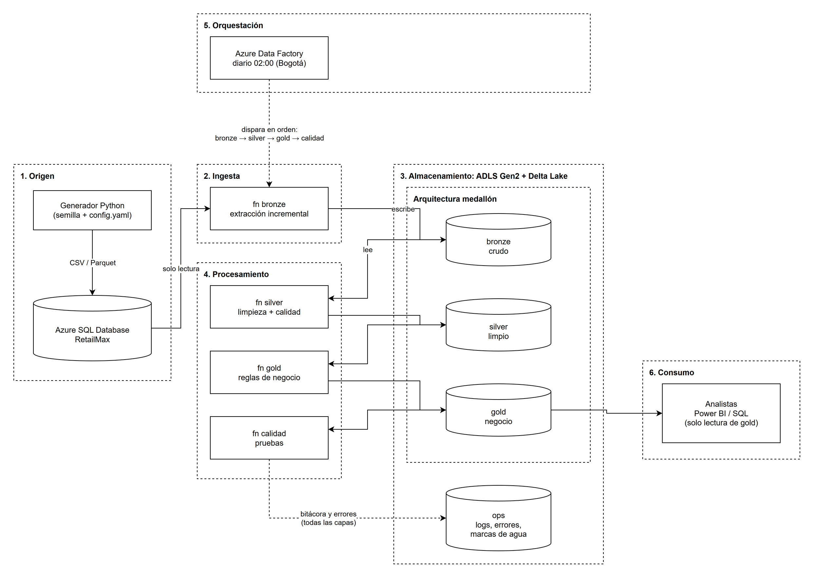
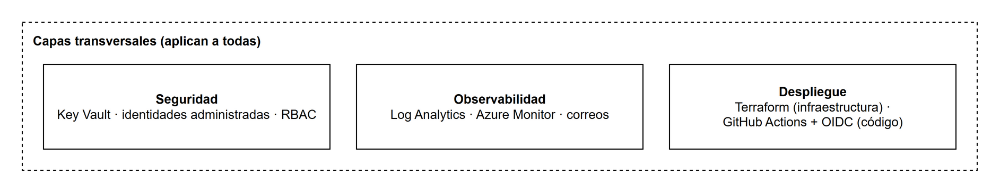
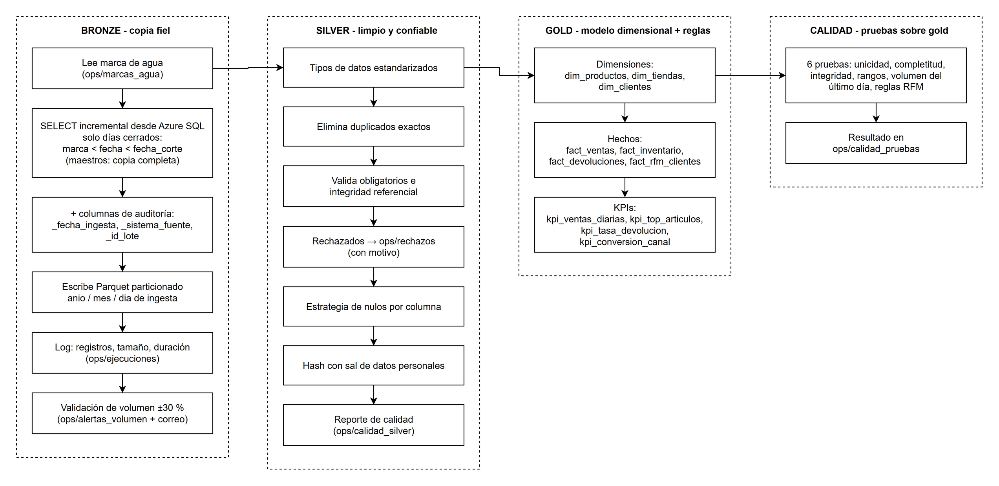
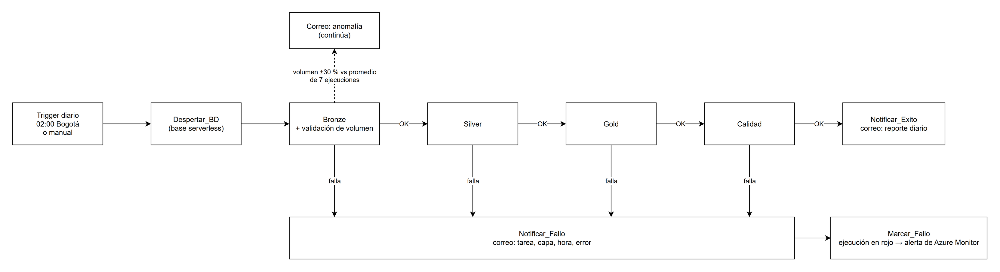

# Arquitectura de la solución: RetailMax Data Pipeline

> Escenario B: Retail y comercio electrónico. Plataforma: Microsoft Azure.
> Diagramas hechos en draw.io; las fuentes editables (`.drawio`) están en [img/](img/).
> Decisión de plataforma y motor: ver [ADR-001](decisiones/ADR-001-plataforma-y-motor-de-procesamiento.md).

---

## 1. Problema y objetivo

RetailMax no tiene visibilidad oportuna de su operación. El inventario se revisa a mano (hasta 48 h sin visibilidad), las campañas de marketing segmentan mal y las devoluciones no tienen análisis de causas.

**Objetivo:** un pipeline automático y diario que consolide los sistemas de origen y entregue datos confiables para cada área.

| Necesidad del negocio | Área | Tabla Gold que la responde |
|---|---|---|
| Referencias en riesgo de quiebre en 7 días | Supply Chain | `fact_inventario` (`alerta_quiebre`) |
| Segmentación RFM semanal (≥ 5 grupos) | Marketing | `fact_rfm_clientes` |
| Tasa de conversión y ticket promedio por canal | Comercial | `kpi_conversion_canal` |
| Devoluciones por motivo, categoría, proveedor y canal | Devoluciones | `fact_devoluciones` |
| Ventas diarias por país, tienda, canal y categoría | Dirección | `kpi_ventas_diarias` (tabla de KPIs ejecutivos) |

---

## 2. Vista general: capas de la plataforma

La solución sigue un estilo **Lakehouse** organizado en capas de plataforma. La **arquitectura medallón** (bronze / silver / gold) no es una capa más: es **la forma en que se organizan los datos dentro de la capa de almacenamiento**. La capa de procesamiento es la que **promueve** los datos de una capa medallón a la siguiente.





| # | Capa de plataforma | Responsabilidad | Servicio |
|---|---|---|---|
| 1 | Origen | Donde nacen los datos | Azure SQL Database |
| 2 | Ingesta | Traer los datos al lago | Function bronze |
| 3 | Almacenamiento | Guardar de forma durable; **contiene el medallón** | ADLS Gen2 + Delta Lake |
| 4 | Procesamiento | Promover datos bronze → silver → gold | Functions silver, gold y calidad (DuckDB / Polars) |
| 5 | Orquestación | Cuándo y en qué orden | Azure Data Factory |
| 6 | Consumo | Entregar a usuarios | Power BI / SQL sobre `gold` (solo lectura) |
| — | Transversales | Seguridad, observabilidad, despliegue | Key Vault, Log Analytics, GitHub Actions + Terraform |

**Principio central:** la base de origen **solo se lee**. Todo el procesamiento ocurre sobre archivos Delta en el Data Lake.

---

## 3. Componentes

| Componente | Servicio Azure | Rol | Por qué |
|---|---|---|---|
| Base de origen | Azure SQL Database (oferta gratuita, serverless) | Simula el sistema transaccional de RetailMax | PaaS, gratuito, auto-pausa, autenticación con Entra ID |
| Data Lake | Storage Account **ADLS Gen2** | Contenedores `bronze`, `silver`, `gold`, `ops` | Almacenamiento barato y durable; permisos por contenedor |
| Formato de tablas | **Parquet** en Bronze; **Delta Lake** (librería `deltalake`) en Silver y Gold | Tablas del lago | Bronze: copia fiel, un archivo por lote. Silver/Gold: ACID, sobrescritura atómica e historial de versiones |
| Procesamiento | **Azure Functions** (Python 3.12, plan Flex Consumption) | Una ruta HTTP (`capas/{capa}`) que ejecuta Bronze, Silver, Gold o Calidad, y otra (`notificar`) para los correos | Serverless: costo ~0 en reposo y sin cuota de vCPU |
| Motor | **DuckDB** (SQL) + Polars | Transformaciones | SQL portable a Spark SQL; suficiente para ~2M filas |
| Orquestación | **Azure Data Factory** | Pipeline diario con dependencias, reintentos y timeouts | Orquestador nativo de Azure con monitor visual |
| Secretos | **Azure Key Vault** | Sal del hash de datos personales y clave de la Function para Data Factory | Cero secretos en el código |
| Identidades | **Identidades administradas** | Function y ADF se autentican sin contraseñas | Mínimo privilegio |
| Logs y auditoría | **Log Analytics** | Logs de Functions, ADF y accesos al Storage | "Quién accedió a qué y cuándo" |
| Alertas | **Azure Monitor + Action Group** | Correo ante fallos | Requisito de la prueba |
| Correos de resumen | **Azure Communication Services (Email)** | Resumen diario, alerta de fallo detallada, anomalía de volumen | 100 % declarable en Terraform, sin conexiones manuales |
| IaC | **Terraform** (`azurerm`) | Toda la infraestructura | Estado remoto, dev/prod por `.tfvars` |
| CI/CD | **GitHub Actions** + OIDC | Validar (CI) y desplegar el código en la Function (CD) | Sin contraseñas guardadas en GitHub |

---

## 4. Flujo de datos por capa



### Tablas de operación (contenedor `ops`)

| Carpeta | Contenido |
|---|---|
| `marcas_agua/` | Última fecha cargada por tabla (carga incremental de Bronze) |
| `ejecuciones/` | Una fila por tabla procesada en cada capa: registros, bytes, duración, estado |
| `pipeline_errors/` | Excepciones capturadas, con tarea, capa, hora y mensaje |
| `rechazos/` | Registros que Silver descartó, con el motivo |
| `calidad_silver/` | Reporte de calidad de Silver por tabla: % nulos, rechazados, % conformes |
| `calidad_pruebas/` | Resultado de cada prueba de calidad sobre Gold (aprobada, fallida o advertencia) |
| `alertas_volumen/` | Anomalías de volumen detectadas en Bronze |

### Idempotencia

- **Bronze:** la marca de agua solo avanza si la escritura termina bien. Cada lote escribe su propio archivo (`<id_lote>.parquet`): reprocesar el mismo lote lo reemplaza, y los lotes anteriores nunca se sobrescriben.
- **Solo días cerrados:** Bronze carga hasta el día anterior a la `fecha_corte` (por defecto, hoy en Bogotá). Una ejecución manual a mitad del día no deja un día a medias. En dev se puede pasar otra fecha como parámetro del pipeline.
- **Silver:** recalcula cada tabla completa desde Bronze y la sobrescribe (Delta, atómico).
- **Gold:** cada tabla se recalcula y se sobrescribe. Las tablas históricas (como `fact_rfm_clientes`) solo reemplazan la partición de su `fecha_corte` y conservan los cortes anteriores. Ejecutar dos veces da el mismo resultado.

---

## 5. Orquestación (Data Factory)



| Requisito | Implementación |
|---|---|
| Dependencias explícitas | Silver solo si Bronze termina bien; Gold solo si Silver termina bien |
| Programación | Trigger diario a las 02:00, zona horaria `SA Pacific Standard Time` (Bogotá) |
| Reintentos | Data Factory: 3 reintentos por capa cada 60 s (5 en `Despertar_BD`; Calidad no reintenta, porque un dato malo no se arregla reintentando). Dentro del código, backoff exponencial por tabla (5, 10, 20 s) en `comun/reintentos.py` |
| Timeout por tarea | 10 min Bronze, Silver y Gold; 5 min Despertar_BD, Calidad y notificaciones |
| Una sola ejecución a la vez | `concurrency = 1`: una segunda ejecución espera en cola |
| Parámetros para ejecuciones manuales | `tablas_bronze` (subconjunto de tablas) y `fecha_corte` (AAAA-MM-DD) |
| Monitoreo sin ver código | Monitor de ADF + carpetas de `ops` + Log Analytics + correos |
| Alertas | Correo propio del pipeline (éxito, fallo, anomalía) y alerta de Azure Monitor sobre ejecuciones fallidas |

**Calidad: error o advertencia.** Las pruebas técnicas (duplicados, llaves nulas, integridad, rangos, RFM)
detienen el pipeline. `volumen_ultimo_dia` (ventas del último día menores al 50 % del promedio diario de
los 28 días previos) es una **advertencia**: una caída de ventas puede ser real (festivo, tienda cerrada),
así que se avisa y el pipeline continúa.

---

## 6. Seguridad y gobierno

### Identidades y permisos (mínimo privilegio)

| Identidad | Permisos | Sobre |
|---|---|---|
| Function App (identidad administrada) | `db_datareader` (solo lectura) | Azure SQL |
| Function App | Storage Blob Data Contributor | contenedores `bronze`, `silver`, `gold`, `ops` |
| Function App | Key Vault Secrets User | Key Vault |
| Function App | Envío de correo | Azure Communication Services |
| Data Factory (identidad administrada) | `db_datareader` (consulta de despertar) | Azure SQL |
| Data Factory | Key Vault Secrets User (lee la clave de la Function) | Key Vault |
| Grupo **Administradores** | **Contributor** (no Owner) + Storage Blob Data Owner + Key Vault Administrator | Grupo de recursos, lago, Key Vault |
| Grupo **Ingenieros de Datos** | Reader + Storage Blob Data Contributor + Data Factory Contributor | Grupo de recursos, las 4 capas, Data Factory |
| Grupo **Analistas** | Reader de la cuenta + Storage Blob Data **Reader** | **Solo** `gold` |
| GitHub Actions (`gh-retailmax-deploy-dev`, OIDC) | Website Contributor | **Solo** la Function App de dev |

- Los usuarios empiezan **sin ningún acceso**; los permisos se dan por grupo y son acumulativos.
- **Administradores con Contributor y no Owner:** el Owner de la suscripción tiene una condición que impide
  delegar roles privilegiados. Contributor da control total de los recursos pero no permite dar permisos:
  los accesos solo se otorgan con Terraform (revisados en código).
- **GitHub sin contraseña:** la identidad de despliegue no tiene secretos; Azure solo acepta tokens firmados
  por GitHub para este repositorio y el ambiente `dev`.

### Datos personales
- Columnas sensibles identificadas y etiquetadas en el catálogo ([catalogo_datos.md](catalogo_datos.md)) y clasificadas en la base de origen (`infra/sql/clasificacion_pii.sql`).
- **Hash SHA-256 con sal** (sal guardada en Key Vault) desde Silver. Es determinista, así que los joins siguen funcionando, y no se puede revertir.
- El Analista solo accede a `gold`, que no contiene datos originales.

### Auditoría
- Logs de diagnóstico del Storage (`StorageRead`, `StorageWrite`) enviados a Log Analytics. Responden "quién leyó qué archivo y cuándo".
- Auditoría de Azure SQL enviada a Log Analytics.

---

## 7. Ambientes y versionamiento

| Ambiente | Dónde | Rama | Despliegue |
|---|---|---|---|
| **local** | Docker (SQL Server 2022) + archivos locales | cualquiera | `docker compose up -d` |
| **dev** | Azure (`*-dev`) | `develop` | Código: automático al cambiar `pipelines/` (GitHub Actions + OIDC). Infraestructura: `terraform apply` manual tras revisar el plan |
| **prod** | Azure (`*-prod`) | `main` | Definido en Terraform (`prod.tfvars`), **no desplegado** |

- El CI (`ci.yml`) corre en cada push y pull request: compila el Python, genera los datos y valida Terraform (`fmt` y `validate`).
- Siguiente paso propuesto: `terraform plan` automático en cada PR y `apply` desde el pipeline con aprobación manual, con una identidad separada de la de despliegue de código.

- Mismo código Terraform; cambian `environments/dev.tfvars` y `prod.tfvars`. Por ejemplo, redundancia **LRS en dev y ZRS en prod**.
- Estado remoto separado por ambiente en un Storage Account dedicado.
- Convención de nombres (abreviaturas de Microsoft CAF): `<tipo>-retailmax-<ambiente>-<sufijo>` (ej. `adf-retailmax-dev-4fr8`, `kv-retailmax-dev-4fr8`). El sufijo aleatorio evita choques con nombres globales. Los recursos que no admiten guiones van sin ellos (ej. `stretailmaxdev4fr8`).

---

## 8. Estructura del repositorio

```
retailmaxDataPlatform/
├── .github/workflows/      # CI y despliegue del código (OIDC)
├── ambiente-local/         # docker-compose (SQL Server 2022) y lago local
├── generacion-datos/       # generador, config.yaml, carga a SQL, DDL, simulación de días
├── infra/                  # Terraform + environments/*.tfvars + scripts SQL + README de despliegue
├── orchestration/          # definición del pipeline de Data Factory
├── pipelines/              # código de la Function: bronze, silver, gold, calidad, comun
├── docs/                   # arquitectura, ADR, modelo ER, catálogo de datos, evidencias
├── README.md
└── CHANGELOG.md
```

---

## 9. Costo estimado (dev)

| Servicio | Modelo de cobro | Estimado mensual |
|---|---|---|
| Azure SQL Database | Oferta gratuita | USD 0 |
| ADLS Gen2 (LRS) | Por GB | < USD 1 |
| Azure Functions (Flex Consumption) | Por ejecución | ~USD 0 |
| Data Factory | Por ejecución de actividad | ~USD 1–3 |
| Key Vault, Log Analytics, Email | Por transacción / GB / correo | < USD 1 |
| **Total** | | **~USD 2–5** |

*Referencia: una capacidad Fabric F2 encendida 24/7 cuesta ~USD 263/mes.* Valores a validar con la calculadora de precios de Azure.
