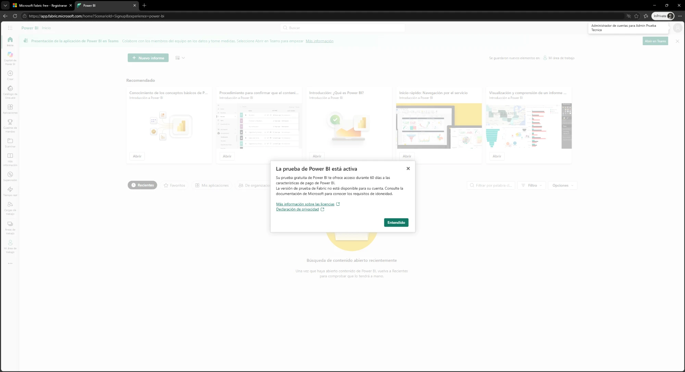
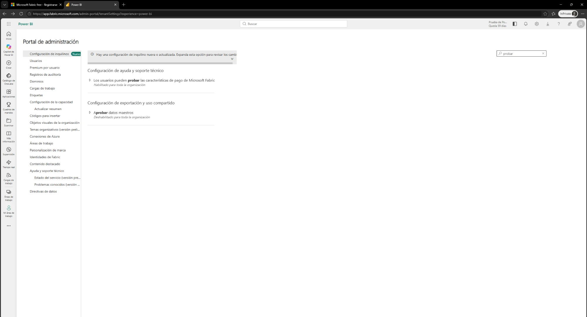
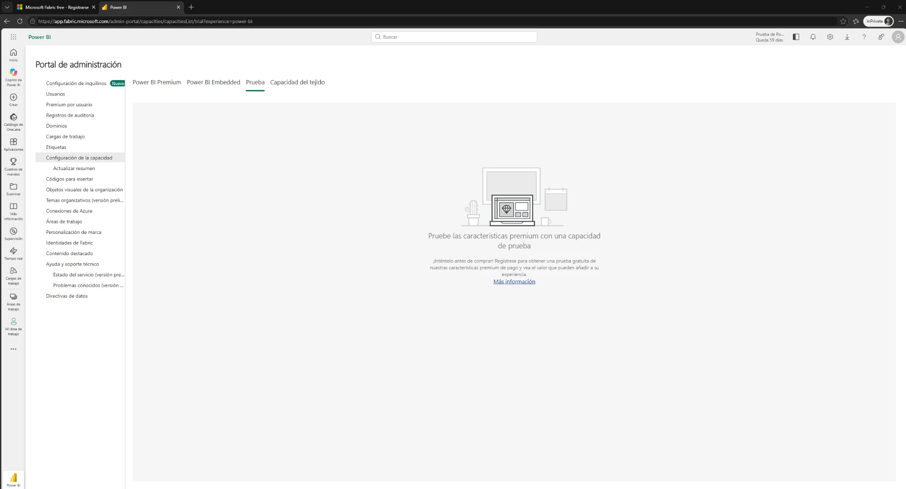
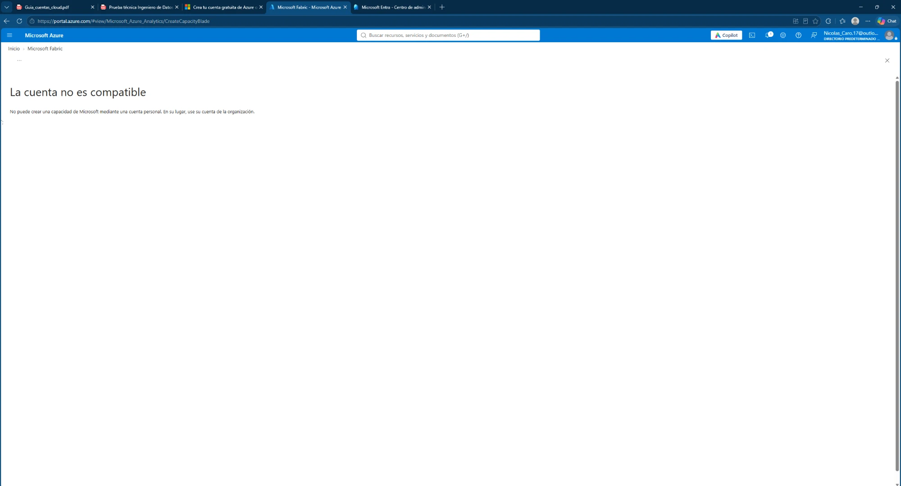
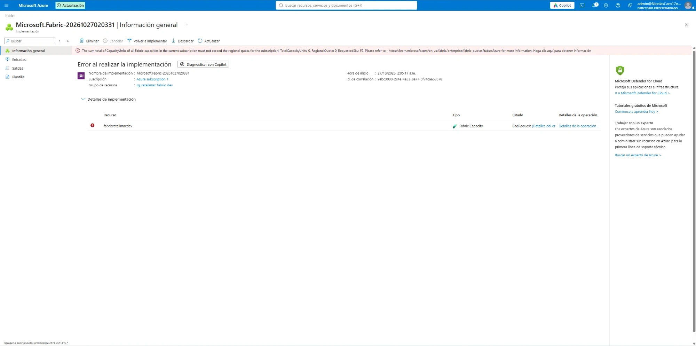

# ADR-001: Plataforma y motor de procesamiento

| Campo | Valor |
|---|---|
| Estado | Aceptada |
| Fecha | 2026-10-27 |
| Autor | Nicolas Caro |
| Fase relacionada | Fase 2 (IaC) y Fase 3 (Pipeline Medallion) |

> ADR (*Architecture Decision Record*): registro corto de una decisión de arquitectura, su contexto y sus consecuencias.

---

## 1. Contexto

La prueba permite elegir entre Microsoft Azure, AWS, Google Cloud o Microsoft Fabric, con libertad en el motor de procesamiento. La primera opción evaluada fue **Microsoft Fabric**, porque integra en una sola plataforma el almacenamiento (OneLake), el procesamiento con Spark, la orquestación (Data Factory) y la visualización (Power BI).

Restricción del proyecto: **costo real cero**. Se usa la cuenta gratuita de Azure (USD 200 de crédito, 30 días) **sin actualizar a pago por uso**, para mantener activo el límite de gasto.

---

## 2. Intentos realizados

### Intento 1: prueba gratuita de Fabric (capacidad F64, 60 días)

1. Se creó un usuario de organización en Microsoft Entra ID (`admin@<tenant>.onmicrosoft.com`), porque Fabric no admite cuentas personales.
2. Desde el portal de Fabric se solicitó la prueba **"Fabric y Power BI"**.
3. **Resultado:** solo se activó la prueba de Power BI. El portal indicó que la versión de prueba de Fabric **no está disponible para la cuenta**.

4. Se verificó que **no era un problema de configuración**: en el Portal de administración, las opciones *"Los usuarios pueden crear elementos de Fabric"* y *"Los usuarios pueden probar las características de pago de Microsoft Fabric"* estaban **habilitadas para toda la organización**.

5. La pestaña **Prueba** de *Configuración de la capacidad* permaneció vacía: no se creó ninguna capacidad de prueba.

**Conclusión:** Microsoft no ofrece la prueba de Fabric a este inquilino (directorio nuevo, sin suscripciones pagadas de Microsoft 365). Es una restricción de elegibilidad del proveedor y no se puede cambiar desde la configuración.

### Intento 2: capacidad de Fabric F2 desde Azure (con el crédito gratuito)

1. Con la cuenta personal, el portal de Azure bloqueó la creación: *"No puede crear una capacidad de Microsoft mediante una cuenta personal"*.

2. Se asignó al usuario de organización el rol **Propietario** sobre la suscripción, con una condición que **excluye** asignar los roles privilegiados (Propietario, Administrador de acceso de usuario y Administrador de RBAC), en aplicación del principio de mínimo privilegio.
3. Se verificó que el proveedor de recursos `Microsoft.Fabric` estuviera **registrado** en la suscripción.
4. Se intentó crear la capacidad `fabricretailmaxdev` con estos parámetros: **F2**, región **South Central US** (región principal del inquilino), *overage protection* desactivado y costo estimado de USD 262,80/mes (~USD 0,36/h).
5. **Resultado:** la validación pasó, pero el despliegue falló con `BadRequest`:

> *The sum total of CapacityUnits of all Fabric capacities in the current subscription must not exceed the regional quota for the subscription! TotalCapacityUnits: 0, **RegionalQuota: 0**, RequestedSku: F2.*

**Causa raíz:** las suscripciones de **prueba gratuita de Azure tienen una cuota regional de 0 CU para Fabric**, y no son elegibles para solicitar aumentos de cuota. Referencia: [Microsoft Fabric quotas](https://learn.microsoft.com/en-us/fabric/enterprise/fabric-quotas?tabs=Azure).

### Alternativa evaluada sin desplegar: Azure Databricks

No se intentó el despliegue. Según la documentación y los foros oficiales de la comunidad, la suscripción de prueba tiene un límite fijo de **4 vCPU** sin posibilidad de ampliación, y Databricks requiere actualizar a pago por uso y solicitar más cuota. Esto contradice la restricción de costo cero y pone en riesgo el calendario.

- [Databricks compute not starting in free trial from Azure (Databricks Community)](https://community.databricks.com/t5/databricks-free-edition-help/databricks-compute-not-starting-in-free-trail-from-azure/m-p/139192)
- [Is Databricks available in Free Tier? (Microsoft Q&A)](https://learn.microsoft.com/en-us/answers/a/923007)

---

## 3. Decisión

Usar **Microsoft Azure** con servicios **serverless** compatibles con la cuenta gratuita, y **Python (Polars / DuckDB) con Delta Lake** como motor de procesamiento en lugar de Spark.

| Componente | Servicio |
|---|---|
| Base de datos origen | Azure SQL Database (oferta gratuita, serverless) |
| Data Lake (bronze / silver / gold) | Azure Data Lake Storage Gen2: Parquet en bronze, Delta Lake en silver y gold |
| Procesamiento | Azure Functions (Python) con Polars / DuckDB + `deltalake` |
| Orquestación | Azure Data Factory |
| Secretos e identidades | Azure Key Vault + identidades administradas |
| Monitoreo y alertas | Log Analytics, Azure Monitor, Action Group, Azure Communication Services (correo) |
| IaC y CI/CD | Terraform + GitHub Actions (OIDC) |

---

## 4. Justificación

1. **Volumen:** el escenario maneja unos 2 millones de filas en total. Cabe en memoria de un solo nodo, y un motor distribuido como Spark agrega costo y complejidad sin beneficio a esta escala.
2. **Costo:** todos los servicios elegidos funcionan dentro de la cuenta gratuita y cobran por consumo. En reposo, el costo es prácticamente cero.
3. **Capacidades equivalentes:** con Delta Lake (librería `deltalake`) se mantienen transacciones ACID, *upserts* (`MERGE`), historial de versiones (*time travel*) y particionamiento, igual que con Spark.
4. **Coherencia con la prueba:** cubre los recursos mínimos que la prueba exige para Azure (Resource Group, ADLS Gen2 con bronze/silver/gold, Data Factory, Key Vault, Log Analytics y Action Group).

---

## 5. Consecuencias

**Positivas**
- Costo real cero y sin bloqueos de cuota.
- Las transformaciones se pueden probar localmente, sin depender de la nube.
- Infraestructura 100 % declarable con el proveedor `azurerm` de Terraform.

**Negativas / riesgos**
- No se usa Spark: hay que documentar el camino de escalamiento (sección 6).
- Las Azure Functions en plan de consumo tienen límites de memoria y tiempo de ejecución. Se mitigan procesando por tabla y por partición.
- Azure SQL serverless tiene arranque en frío: la primera consulta del día tarda más. Es un compromiso aceptado entre costo y latencia.

---

## 6. Camino de escalamiento

Si el volumen creciera de 100 a 1.000 veces, se migrarían las transformaciones a **PySpark** en Azure Databricks o Microsoft Fabric:
- Las tablas **Delta Lake** existentes se leen sin cambios desde Spark.
- La lógica escrita en Polars se traduce de forma casi directa al API de DataFrames de PySpark.
- La orquestación en Data Factory se mantiene, cambiando la actividad de Azure Function por una de Notebook/Job.

---

## 7. Limpieza pendiente

- Eliminar el grupo de recursos vacío `rg-retailmax-fabric-dev`, que quedó del intento 2.
