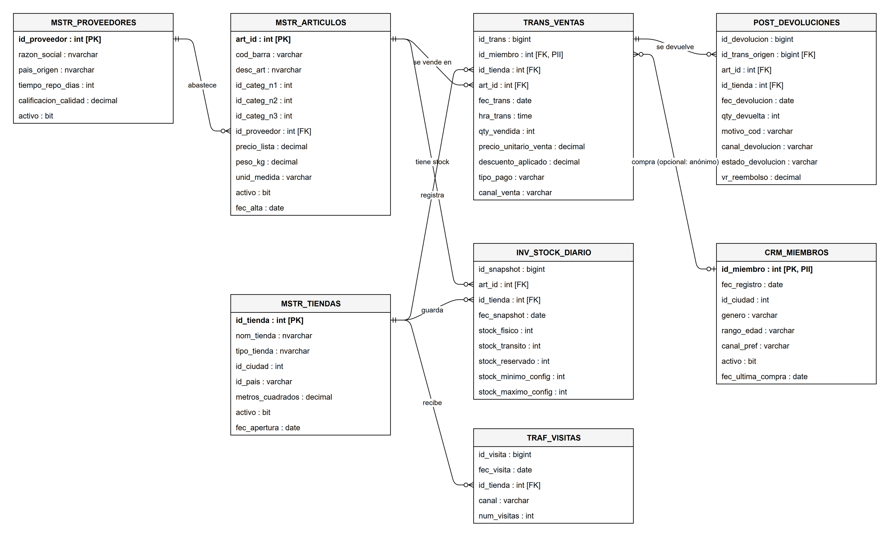
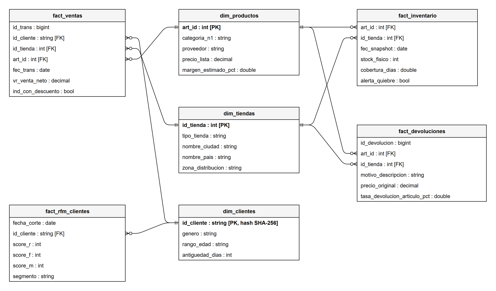

# Modelo de datos — RetailMax

Diagramas hechos en draw.io; las fuentes editables (`.drawio`) están en [img/](img/).

## 1. Modelo relacional de origen (Azure SQL)

Los maestros tienen llave primaria. Las tablas transaccionales **no tienen PK ni FK**, simulando un
sistema legado: por eso pueden existir duplicados y referencias rotas, que Silver detecta.
Las relaciones del diagrama son **lógicas** (no están declaradas en la base).

## 2. Modelo dimensional de Gold (estrella)

Las dimensiones salen de los maestros; los hechos, de las transaccionales. Las tablas `kpi_*` son
agregaciones sobre los hechos para consumo directo en dashboards.

Tablas de agregación (KPIs): `kpi_ventas_diarias` (tabla de KPIs ejecutivos), `kpi_top_articulos`,
`kpi_tasa_devolucion`, `kpi_conversion_canal`. Detalle de cada campo en [catalogo_datos.md](catalogo_datos.md).
